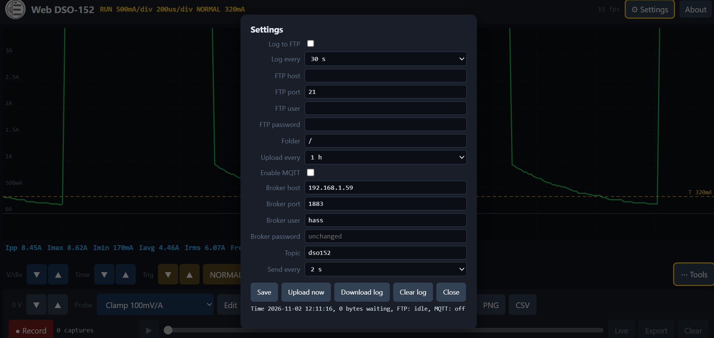

# DSO152-esp32-web

Web DSO-152: wifi viewer for the FNIRSI DSO152 pocket scope.

I received this FNIRSI DSO152 as a gift few years back.  Its rarely used , i dont like the small screen and I have better scopes. So this was vibe coded out of bordem. The original firmware still used, but it uses ESP32 reads the scopes memory over the SWD debug pads and puts it on a web page on my wifi. The esp32 is powered from the voltage pad ( scopes power driver) so far I have not had issues. I would not recommend doing this. Do this at your own risk.


| phone | cursors |
|---|---|
|  |  |



## What it does

- live trace on a grid that matches the scope screen: 12 x 8 divisions, 300 points, V/div and time/div taken from the scope
- the scope's own Vpp/Vmax/Vmin/Vavg/Vrms, plus frequency and duty cycle worked out in the browser
- remote V/div, time/div, trigger level, trigger mode and RUN/STOP
- time cursors (t1, t2, Δt, V(t1), V(t2)) and volt cursors (V1, V2, ΔV)
- zoom and pan: wheel for time, shift+wheel for volts, pinch on a phone, drag to pan, double tap to reset
- probes: 100/10/1 mV/A current clamps, a 0-100 psi sender, or make your own with a unit, mV per unit, 0 at V and invert. ( not fully tested)
- recording and playback in the browser, CSV export, PNG screenshot
- background logging to FTP, sampled every 10/30/60 s or 5 min, uploaded every 15 min to 6 h
- MQTT publishing as JSON every 1/2/5/10 s, plus a cmd topic for RUN/STOP
- a settings popup for all of that, and the page works on phones

## Before you start, the scope

heads up. the DSO152 flash is read protected from factory and that blocks SWD memory reads too. taking the protection off erases the whole chip, FNIRSI bootloader included, so you have to reflash the scope after.

What  I used :

1. ST-Link V2 on the SWD pads, OpenOCD `stm32f1x unlock 0` (mass erase).
2. Flashed a 32-byte boot stub (`tools/boot_stub.bin`) at `0x08000000` and the stock app (`DSO152_APP_V0.1.bin`) at `0x08003C00`. The stub replaces the erased bootloader: it points the vector table at `0x08003C00` and jumps to the app.

The app must sit at `0x08003C00`. Flashed at `0x08000000` the scope will not start. I don't include FNIRSI firmware here, use the image from your own unit or from FNIRSI.

Things I ran into:

- SWDIO and SWCLK were swapped on my board. If the debugger can't connect, swap the two wires.
- Don't drive "unused" MCU pins. PA2 looked free in the firmware but is wired to something on the board. Driving it made a relay chatter and blanked the screen.

## Hardware

| ESP32 board | SWCLK | SWDIO |
|---|---|---|
| ESP32-C3 (SuperMini etc.), `env:esp32c3` | GPIO4 | GPIO5 |
| ESP-WROOM-32 DevKit, `env:esp32dev` | GPIO18 | GPIO19 |

Wiring to the scope's SWD pads:

```
scope SWCLK ESP SWCLK pin
scope SWDIO ESP SWDIO pin
scope GND   ESP GND
scope 3.3V  ESP 3.3v
```

I would recommend using resistors between comm pads for extra protection, in case one side is powered and the other isnt or both end up driving SWDIO. mine worked without them but put them in if its staying in there.

unplug the ST-Link first. one debugger at a time.

keep your wires away from the reset pad. had one touching it and the scope kept resetting, took me a while to figure that out.

there's also a laptop version in `tools/swd_viewer.py` that does the same thing over an ST-Link + OpenOCD, no esp needed (set `OPENOCD` to your openocd.exe if its not on PATH).

### Power from the scope battery (3.7 V Li-ion)

**do NOT put the battery straight on the ESP32 3V3 pin.** a full cell is 4.2 V and the ESP32 max is 3.6 V. I did this with a DevKit and it ended up stuck in a power-on-reset loop.

Current is about 20-40 mA connected to Wi-Fi with no page open, more while streaming.

## Build and flash the ESP32

You need PlatformIO (VS Code extension or CLI).

```bash
pio run -e esp32c3 -t upload
```

Use `-e esp32dev` for an ESP-WROOM-32 DevKit. DevKits with a CP2104/CP2102 USB chip need the Silicon Labs CP210x driver on Windows.

Serial log is 115200: `pio device monitor`. It prints the SWD connection result, the IP address, and a speed line every 5 s while a page is open.

## First Wi-Fi setup

1. Power the ESP32. If it doesn't know a network it opens a Wi-Fi network called **DSO152-Setup** for 3 minutes.
2. Join it from a phone; a setup page opens (or go to `192.168.4.1`).
3. Pick your Wi-Fi, enter the password, save. It's stored on the ESP32.
4. Open **http://dso152.local** (or the IP from the serial log) from any PC or phone on that network.

To change networks later, erase the ESP32's flash (`pio run -e esp32c3 -t erase`) and reflash.

## Using it

- V/div, Time and Trig send the scope's own key presses. Each press takes about 0.3 s and moves the scope's menu cursor, same as pressing its buttons.
- Mode cycles AUTO / NORMAL / SINGLE. RUN/STOP does what it says. The yellow dashed line is the trigger level; Trig up/down moves it.
- The trace only changes when the scope finishes a capture. While it waits for a trigger or sits stopped, you see the last capture, like the scope screen.
- Tools has 0 V up/down (moves the zero line on the page), the probe picker, time and volt cursors, Freeze view, fps, PNG and CSV.
- Drag a cursor to move it. Time cursors show t1, t2, Δt, V(t1) and V(t2). Volt cursors show V1, V2 and ΔV.
- Zoom with scroll wheel . Or pinch and  drag to pan, double tap to reset. Zoom stops at 16x.
- Record keeps captures in browser memory.  Play, scrub or go back to Live. Export writes one row per capture with all 300 points. PNG saves the screen with the readings.

## Logging and MQTT

All of it is in the Settings popup. Tick "Log to FTP", fill in host, port, user, password and folder, choose the sample interval (10/30/60 s or 5 min) and the FTP upload interval  15 to 60 min. 

Samples go into esp memory 1st , then get saved to a daily file like `dso152_2026-11-02.csv` on the FTP server. 

## Testing 

What I have yet to test is battery life with the ESP.  But I plan on leaving it with a charger and doing some automotive battery drain capturess. 

Well it's a slow Oscilliscope and the UI can only do 10- 25 FPS. 

