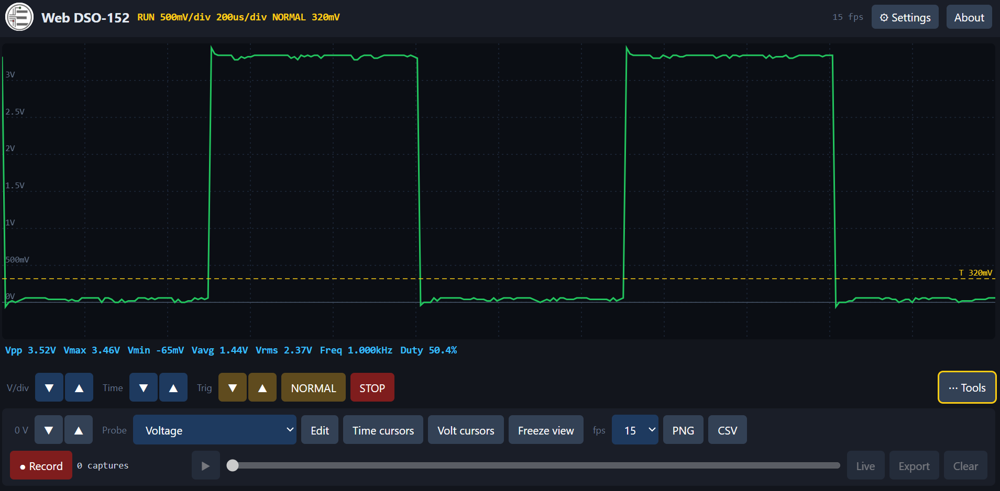
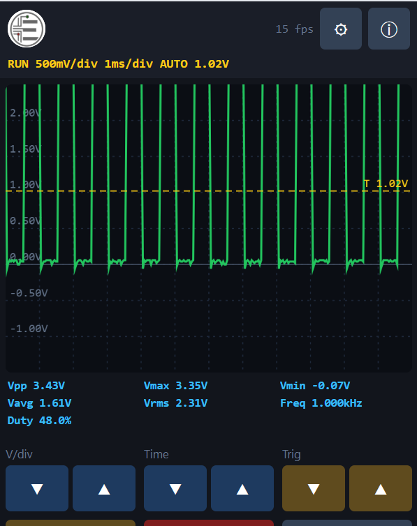
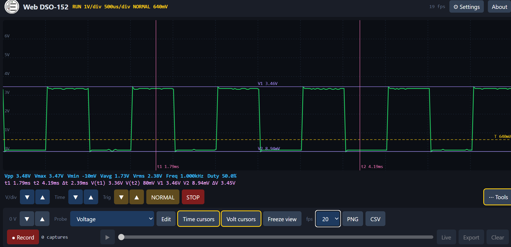
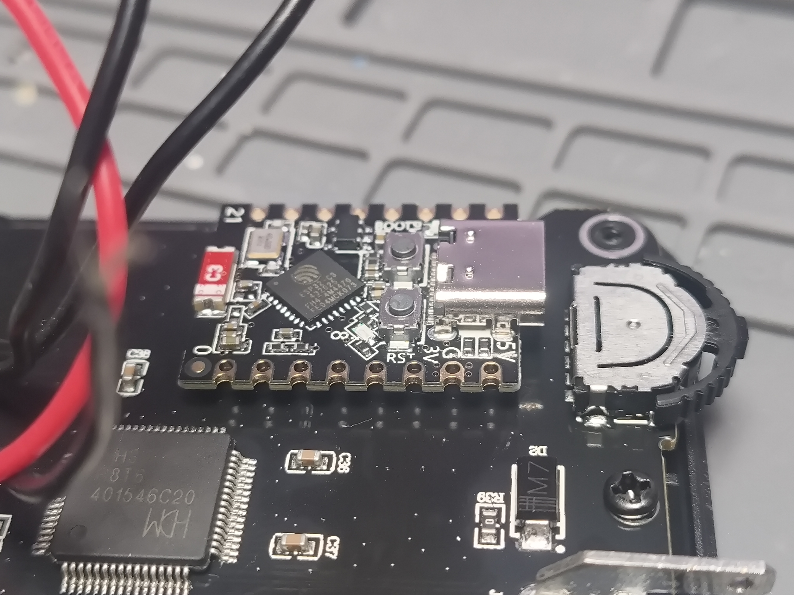
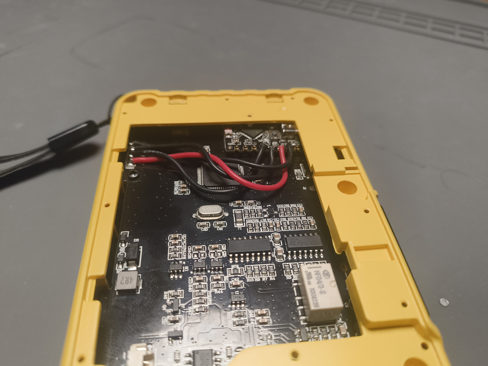

# DSO152-esp32-web

Web DSO-152: wifi viewer for the FNIRSI DSO152 pocket scope.

I received this FNIRSI DSO152 as a gift. Its rarely used, i don't like the small screen and I have better scopes. So this was done out of boredom. The original scope firmware is still used, an ESP32 reads the scope's memory over the debug pads and puts it on a web page on my WIFI. The esp32 is powered from the scope's 3.3V pad, so far I have not had issues. The esp fits under the battery, I added some wire to the antenna to get more WIFI range.

**Do this at your own risk.**

| phone | cursors |
|---|---|
|  |  |
| **Esp32** | **Case** |
|  |  |

## What it does

- live scope trace on your phone or pc, same grid as the scope screen
- the scope's own readings (Vpp, Vmax, Vmin, Vavg, Vrms) plus frequency and duty cycle
- change V/div, time/div, trigger and RUN/STOP from the page
- time and volt cursors
- zoom and pan, pinch on a phone
- current clamps, pressure sender, or make your own probe
- record and play back, save as CSV or PNG
- log to an FTP server or send to MQTT (home assistant etc.)

## Step 1, the scope

the scope comes locked from factory and the esp can't read it locked. unlocking erases the whole scope, so you have to put the firmware back after.

I used an ST-Link V2 on the scope's debug pads:

1. unlock it (this wipes it)
2. flash `firmware/DSO152-scope_boot_stub.bin` at `0x08000000`
3. flash the FNIRSI app (`DSO152_APP_V0.1.bin`) at `0x08003C00`

things I ran into:

- the SWDIO and SWCLK labels were swapped on my board. if it won't connect, swap the two wires.

## Step 2, flash the esp32

ready made files are in the `firmware/` folder. no software to install.

| board | file | scope SWCLK to | scope SWDIO to |
|---|---|---|---|
| ESP32-C3 SuperMini | `DSO152-esp32-web_esp32c3.bin` | GPIO3 | GPIO4 |
| ESP32 DevKit | `DSO152-esp32-web_esp32dev.bin` | GPIO18 | GPIO19 |

plus scope GND to esp GND, and scope 3.3V to esp 3V3.

on the C3 mini I used 4 pins in a row on one side: GND, 3V3, GPIO4, GPIO3. if the page says scope not connected, swap the two data wires. if the wifi signal is weak, add a wire antenna.

C3 not showing up? hold BOOT while you plug it in.

a few warnings:

- **do NOT put the scope battery straight on the esp 3V3 pin.** a full battery is 4.2V, too much for the esp. I did it and it would not boot.

## Step 3, wifi

1. power it up. the first time it makes its own hotspot called **DSO152**, password `dso152scope`.
2. join it from your phone, the page should pop up (or go to `192.168.4.1`). the scope works right there on the hotspot, handy in the car.
3. open Settings (gear), wifi is at the top. Scan, pick your network, type the password, Add network.
4. hit Connect now.
5. join that same network with your phone/pc and open **http://dso152.local**

it remembers up to 6 networks and joins whichever one it finds. add home, shop, phone hotspot etc. and take it anywhere. if none are around it goes back to its own hotspot.

## Using it

- V/div, Time and Trig work like pressing the scope's buttons, give each press a moment.
- Mode switches AUTO / NORMAL / SINGLE. the yellow dashed line is the trigger level.
- the trace updates when the scope takes a new capture, same as the scope screen.
- Tools has the probe picker, cursors, freeze, PNG and CSV.
- Record keeps captures in the browser, then play them back or save them.

## Logging

in Settings (gear). tick "Log to FTP", fill in your FTP server, pick how often. it saves a daily file like `dso152_2026-11-02.csv`. MQTT is in there too.
